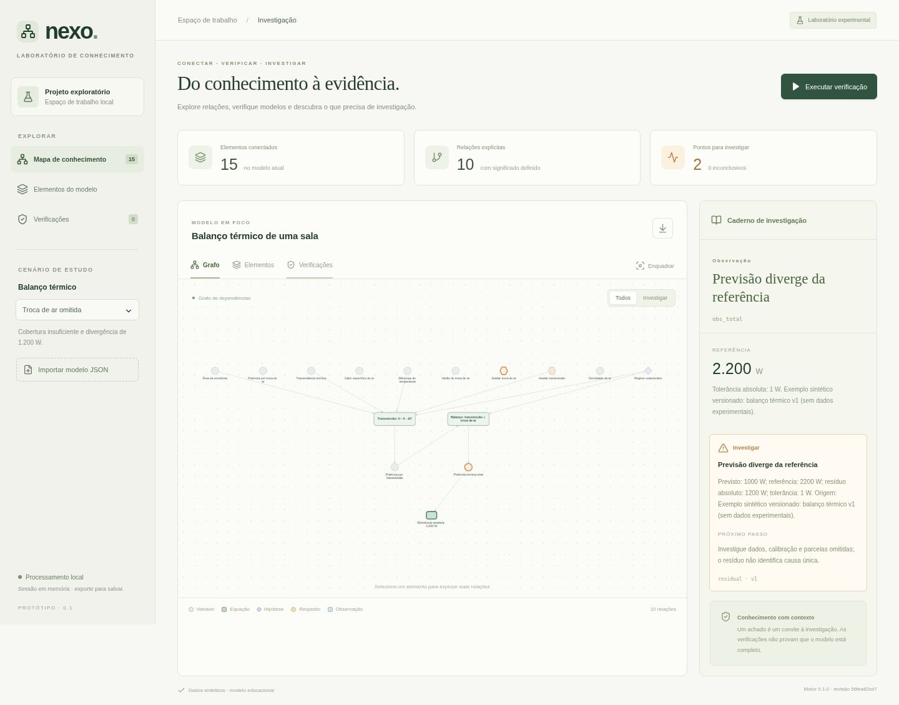

# Mathematical-Causal Knowledge Graph with Gap Analysis

**Nexo** — nome provisório de um laboratório desktop para explorar conhecimento,
verificar modelos e investigar lacunas matemáticas, científicas e de software.

O objetivo final é conectar problemas, equações, variáveis, hipóteses, evidências,
requisitos e elementos de sistemas em um grafo auditável. A aplicação deverá ajudar
a entender o que explica um resultado, quais dependências faltam e quais afirmações
precisam de investigação. Novas relações sugeridas serão hipóteses até serem validadas.

**Estado:** primeiro protótipo funcional do motor e da interface, validado na nuvem.
O host Tauri está implementado; o aplicativo e o instalador **Windows ainda precisam
de compilação e validação nativas**. Análise geral de código e arquivos de projetos
ainda não está implementada.

## Retomar o desenvolvimento

Leia nesta ordem:

1. [Contexto do projeto](docs/CONTEXTO_PROJETO.md): objetivo final, decisões e mapa do código.
2. [Estado atual](docs/ESTADO_ATUAL.md): o que funciona, evidências, limitações e próximo passo.
3. [Plano de implementação](docs/PLANO_IMPLEMENTACAO.md): épicos, rodadas e critérios de aceite.
4. [Instruções para agentes](AGENTS.md): regras para manter a continuidade.

O [relatório inicial](docs/RELATORIO_INICIAL.md) contém a pesquisa e a arquitetura
proposta. Ele também descreve capacidades futuras; use o estado atual para saber
quais já existem.

## Primeiro protótipo

- Explorar um grafo interativo de equações, variáveis, hipóteses e requisitos.
- Selecionar elementos pelo grafo ou por uma lista navegável por teclado.
- Executar verificações reais de integridade, unidades, dependências, cobertura e resíduos.
- Investigar cada resultado com evidência, regra aplicada e próximo passo.
- Importar e exportar modelos JSON no fluxo de navegador usado no desenvolvimento.
- Reproduzir quatro cenários térmicos: completo, entrada ausente, unidade inválida e troca de ar omitida.

No exemplo completo, transmissão = **1.000 W**, troca de ar = **1.200 W** e total =
**2.200 W**. Omitir a troca de ar produz um achado de cobertura e uma divergência
de **1.200 W** em relação à referência sintética. Isso demonstra as verificações;
não é uma descoberta científica ou um ensaio de desempenho de edifícios reais.



A imagem representa o frontend exercitado no Chromium na nuvem, não uma janela
Windows já validada.

## Arquitetura

| Componente            | Tecnologia                          | Papel                                                          |
| --------------------- | ----------------------------------- | -------------------------------------------------------------- |
| Aplicativo desktop    | Tauri 2 + Rust                      | Janela, permissões e execução do motor empacotado              |
| Interface             | React 19 + TypeScript + Vite        | Fluxo gráfico e apresentação de achados                        |
| Visualização          | Cytoscape.js                        | Grafo interativo, seleção e enquadramento                      |
| Motor                 | Python 3.12 + Pydantic              | Contratos, exemplos e verificações auditáveis                  |
| Matemática e unidades | SymPy + Pint                        | Expressões construídas de forma restrita e quantidades físicas |
| Dependências          | NetworkX                            | Estrutura do grafo e ordenação de cálculos acíclicos           |
| Comunicação           | JSON versionado por stdin/stdout    | Mesmo motor para desktop e testes                              |
| Persistência atual    | Sessão em memória + exportação JSON | SQLite e histórico persistente estão planejados                |

Rust fica responsável pela integração nativa. Otimizações adicionais dependem de
medições separadas de análise, transporte, layout e renderização. Não há necessidade
de reescrever todo o motor para melhorar um componente específico.

O processo Python é iniciado para cada requisição desktop e encerrado após responder.
Esse caminho simples facilita o controle do ciclo de vida; o custo de inicialização
ainda deverá ser medido no Windows. O host limita tamanho das requisições, concorrência
e tempo de execução. Ele não é uma sandbox para executar código de terceiros.

## Desenvolvimento local no Windows

O primeiro alvo de distribuição é **Windows x64**. O usuário final deverá instalar
apenas o aplicativo; as ferramentas abaixo são necessárias para desenvolver e compilar.

Pré-requisitos:

- Git, Node.js 24 e Python 3.12.
- `uv` 0.12.23, ou versão compatível com o lockfile.
- Rust via rustup; o repositório fixa o toolchain em `rust-toolchain.toml`.
- Visual Studio Build Tools com a carga **Desenvolvimento para desktop com C++** e Windows SDK.
- Microsoft Edge WebView2 Runtime.

Consulte os [pré-requisitos oficiais do Tauri](https://v2.tauri.app/start/prerequisites/).
Depois de instalar ferramentas e configurar o PATH, abra um novo PowerShell:

```powershell
git clone https://github.com/guilhermebo0510/Mathematical-Causal-Knowledge-Graph-with-Gap-Analysis.git
cd Mathematical-Causal-Knowledge-Graph-with-Gap-Analysis
uv sync --frozen
npm ci
rustup show
```

Se a pasta já contiver um clone, use esse clone e confira suas alterações antes de
atualizar. Não clone outro repositório dentro dele.

Para preparar o motor e abrir o desktop:

```powershell
npm run engine:bundle
uv run python scripts/smoke_sidecar.py
npm run desktop:dev
```

O empacotador usa PyInstaller e o target triple do host. Não copie o binário Linux
gerado na nuvem para o Windows; gere um `.exe` no próprio Windows.

Para produzir o instalador Windows:

```powershell
npm run desktop:build -- --bundles nsis
```

Saída esperada: `apps/desktop/src-tauri/target/release/bundle/nsis/`.
Esses comandos Windows estão preparados para a próxima rodada, mas não foram
executados nesta máquina Linux. O primeiro instalador será sem assinatura digital;
assinatura e atualizações automáticas não foram configuradas.

## Interface na nuvem ou no navegador de desenvolvimento

```bash
uv sync --frozen
npm ci
npm run dev
```

O adaptador do Vite chama o motor Python real. Ele só existe no modo desenvolvimento;
o frontend de produção usa o comando Tauri, sem depender desse servidor. Abrir o
HTML gerado isoladamente não substitui a execução desktop.

Na máquina Codex preparada nesta rodada, use `. scripts/cloud-env.sh` para ativar
os caminhos do Rust e do Chromium existentes. Processos não sobrevivem necessariamente
à troca de tarefa. Continue usando o checkout já presente, sem criar outro worktree.

## Testes e verificações

```bash
uv run ruff check services scripts tests/engine
uv run pytest -q
npm run test
npm run build
```

Para os testes de navegador:

```bash
npx playwright install chromium
npm run test:e2e
```

Na nuvem atual o download do Playwright foi bloqueado pela política de rede, mas o
Chromium do sistema funcionou. Nesse caso:

```bash
PLAYWRIGHT_CHROMIUM_EXECUTABLE=/usr/bin/chromium npm run test:e2e
```

Para testar a ponte Rust contra o Python empacotado no Windows:

```powershell
$targetTriple = rustc --print host-tuple
$env:KNOWLEDGE_ENGINE_BINARY = (Resolve-Path "apps/desktop/src-tauri/binaries/knowledge-engine-$targetTriple.exe").Path
cargo test --locked --manifest-path packages/desktop-bridge/Cargo.toml
```

O teste da ponte exige o executável: não será silenciosamente ignorado se ele faltar.
As evidências e contagens efetivamente verificadas estão no documento de estado.

## Organização

```text
apps/desktop/src/             Interface React e adaptador de transporte
apps/desktop/src-tauri/       Host Tauri, permissões e configuração de distribuição
packages/desktop-bridge/     Transporte Rust/Python testável sem WebView
services/engine/             Motor, esquema, exemplos e protocolo
scripts/                    Empacotamento e smoke test do executável
tests/engine/               Testes científicos, integridade e segurança de entrada
tests/ui/                   Fluxos de navegador com motor real
.github/workflows/           Validação e proposta de build Windows
docs/                       Contexto, estado, plano e pesquisa
```

## Continuidade e próximos passos

O próximo passo é **validar o desktop no Windows**, incluindo instalador, comunicação
com o motor e importação/exportação de arquivos. Depois vêm persistência e edição
de projetos, análise delimitada de software e documentos, verificadores adicionais
e integração com GitHub.

O workflow de CI foi escrito para validar o motor e a interface e construir o
instalador em runner Windows. A existência do workflow não comprova sua execução
nem o funcionamento do instalador. Veja a aba Actions após o envio do código.

O projeto ainda não define uma licença de distribuição própria. Consulte as fontes
e licenças dos componentes antes de redistribuir o software ou dados de terceiros.
