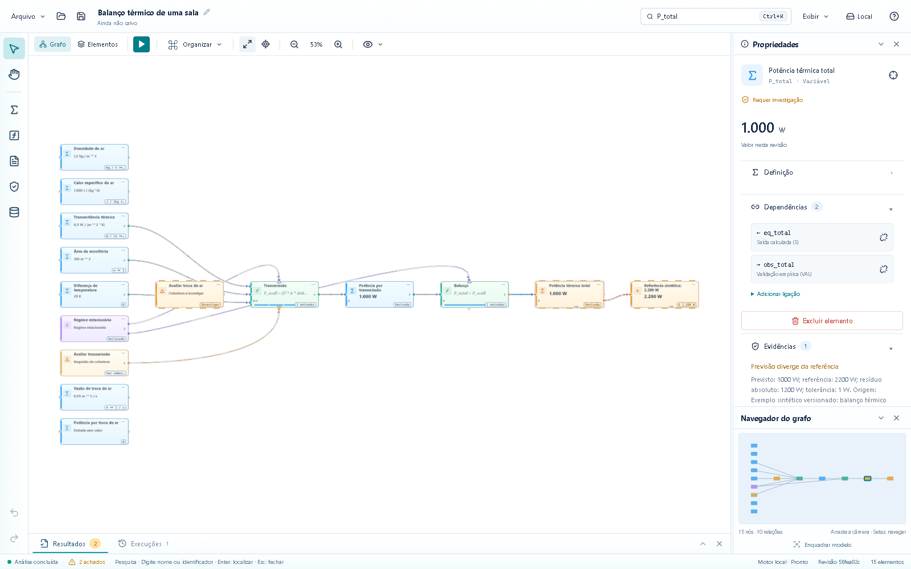

# Mathematical-Causal Knowledge Graph with Gap Analysis

**Nexo** — nome provisório de um laboratório desktop para explorar conhecimento,
verificar modelos e investigar lacunas matemáticas, científicas e de software.

O objetivo final é conectar problemas, equações, variáveis, hipóteses, evidências,
requisitos e elementos de sistemas em um grafo auditável. A aplicação deverá ajudar
a entender o que explica um resultado, quais dependências faltam e quais afirmações
precisam de investigação. Novas relações sugeridas serão hipóteses até serem validadas.

**Estado:** protótipo funcional com aplicativo e instalador compilados e exercitados
no Windows local, incluindo janela, motor e importação/exportação, além do novo
**viewport em Rust + WebAssembly + WebGL2 na GPU** (`packages/viewport-core`).
**A R2 permanece aberta:** instalação em Windows limpo (fase final), limites de
recursos no worker MCP e validação da distribuição ainda estão pendentes. Cancelamento nativo
com contenção e orçamento de memória comprometida/CPU dos processos no Windows já
foi implementado e exercitado. Análise geral de código e arquivos de
projetos ainda não está implementada. Veja as evidências em [Estado atual](docs/ESTADO_ATUAL.md).

## Retomar o desenvolvimento

Leia nesta ordem:

1. [Contexto do projeto](docs/CONTEXTO_PROJETO.md): objetivo final, decisões e mapa do código.
2. [Estado atual](docs/ESTADO_ATUAL.md): o que funciona, evidências, limitações e próximo passo.
3. [Plano de implementação](docs/PLANO_IMPLEMENTACAO.md): épicos, rodadas e critérios de aceite.
4. [Instruções para agentes](AGENTS.md): regras para manter a continuidade.

O [relatório inicial](docs/RELATORIO_INICIAL.md) contém a pesquisa e a arquitetura
proposta. Ele também descreve capacidades futuras; use o estado atual para saber
quais já existem.

## Primeiro protótipo

- Explorar um grafo interativo de equações, variáveis, hipóteses e requisitos.
- Selecionar elementos pelo grafo ou por uma lista navegável por teclado.
- Executar verificações reais de integridade, unidades, dependências, cobertura e resíduos.
- Investigar cada resultado com evidência, regra aplicada e próximo passo.
- Importar e exportar modelos JSON no fluxo de navegador usado no desenvolvimento.
- Reproduzir quatro cenários térmicos: completo, entrada ausente, unidade inválida e troca de ar omitida.

A interface clara ocupa a janela como área de trabalho: pesquisa global, barra
de ferramentas, **viewport em Rust + GPU (WebGL2)** e propriedades recolhíveis.
Dentro do viewport, todos os elementos — nós, portas estruturadas de entrada (`E`),
saída (`S`), hipótese (`HIP`), requisito (`REQ`) e validação (`VAL`), ligações
curvas roteadas porta a porta e indicadores de entradas disponíveis —
são construídos em Rust e desenhados diretamente na placa de vídeo, sem cartões
DOM/SVG por nó. A capacidade para projetos grandes ainda depende das medições
de renderização e dos limites do motor científico.

**Exibir** recupera os painéis fechados e restaura a disposição inicial. O navegador
do grafo é opcional; clique/arraste o minimapa para mover
a câmera. Resultados ficam embaixo, com recolhimento, altura ajustável e filtros.
**Histórico** preserva até 20 análises/8 MB no perfil local, com modelo, revisão e
evidências somente leitura. Consultar uma execução antiga não muda a análise atual.
No grafo, a roda aproxima no cursor; arrastar o fundo move a câmera. Há ferramentas
de seleção/movimentação, zoom de 10% a 400%, escala real, enquadramento geral e da
seleção e reorganização por dependências. A câmera permanece durante verificações,
trocas de aba e redimensionamentos; carregar outro modelo redefine o enquadramento.
Os nós mostram nomes básicos na visão geral e valores/unidades, fórmulas, portas
e definição ao aproximar. As barras das equações indicam entradas, sem comparar
magnitudes de unidades diferentes. O botão de três pontos (`⋯`) de cada nó no
canvas GPU permite inspecionar ou enquadrar o elemento. O controle de visibilidade
começa fechado e filtra tipos de elementos, destaca achados e oferece uma legenda opcional.

Atalhos: **Ctrl+K** pesquisar, **Ctrl+O** abrir projeto, **Ctrl+S** salvar projeto,
**Ctrl+Shift+S** salvar como, **Ctrl+Z/Ctrl+Shift+Z** desfazer/refazer edição e **F5** verificar. Com o viewport em
foco: **F/Home** enquadrar, **0** escala real, **+/−** zoom e setas para mover a câmera.

**Arquivo → Novo projeto** começa um modelo sem dados inventados. Clique no nome
na barra para renomear. No Windows, salvar/abrir usa diálogos nativos; o arquivo
`.nexo.json` guarda modelo, posições, câmera, visibilidade e painéis. No navegador
de desenvolvimento, salvar solicita download. Ao reabrir, execute novamente para
obter resultados na revisão atual; o arquivo ainda não armazena histórico científico.
O JSON antigo de modelo continua importável/exportável pelo menu Arquivo.

Na lateral ficam seleção, pan, criação de nós e desfazer/refazer. Exibir concentra
os painéis. Propriedades permite editar valor, unidade, fonte, expressão, saída,
hipótese, requisito e referência/tolerância; **Aplicar alterações** confirma o
formulário. Rótulos não modificam expressões, e uma edição invalida a evidência anterior.
O rodapé oferece ajuda contextual. **Local** explica origem e execução: GitHub e
análise remota ainda são integrações futuras.

O [roteiro do laboratório](docs/EVOLUCAO_DO_LABORATORIO.md) especifica os próximos
critérios de nós, grupos/feixes, objetivos/fontes, propostas e construção em tempo real.

Há também um [conector local experimental](docs/CONECTOR_LOCAL.md) JSON por linha:
`uv run python -m knowledge_engine.connector`. Um cliente independente de fornecedor
pode criar/editar modelos com revisão esperada, analisar e consultar evidências.
É uma sessão separada em memória, sem controle da janela ou acesso a pastas/GitHub;
O [adaptador MCP local](docs/MCP_LOCAL.md) usa o SDK oficial como extra opcional:
`uv run --extra mcp python -m knowledge_engine.mcp_server`. Não controla a janela.
`uv run python scripts/validate_connector.py` reproduz um
controle aritmético e um defeito conhecido e gera modelos importáveis no aplicativo.
`uv run --extra mcp python scripts/validate_mcp.py` exercita handshake/ferramentas
com um circuito sintético válido e uma referência errada de propósito.
**Arquivo → Revisar proposta…** permite conferir e aplicar um lote portátil do
MCP ao projeto atual, com comparação de conteúdo, análise invalidada e Desfazer;
veja [Propostas](docs/PROPOSTAS.md). Ainda não existe envio direto à janela.

No exemplo completo, transmissão = **1.000 W**, troca de ar = **1.200 W** e total =
**2.200 W**. Omitir a troca de ar produz um achado de cobertura e uma divergência
de **1.200 W** em relação à referência sintética. Isso demonstra as verificações;
não é uma descoberta científica ou um ensaio de desempenho de edifícios reais.



A captura mostra a interface no Edge Windows durante os testes automatizados.
A validação da janela nativa está registrada no documento de estado.

## Arquitetura

A identidade visual fica em [assets/brand](assets/brand/README.md), com
[guia visual](assets/brand/index.html), logotipos SVG/PNG, ícones Windows, splash,
paleta e iconografia. Para regenerar os arquivos, sem build do aplicativo:
`node scripts/generate_brand_assets.mjs`. A abertura mostra a marca enquanto
o modelo inicial é carregado; não há atraso artificial. Alterações dos ícones
nativos entram na próxima compilação do host, enquanto React/CSS usam hot reload.

| Componente                 | Tecnologia                                             | Papel                                                                                      |
| -------------------------- | ------------------------------------------------------ | ------------------------------------------------------------------------------------------ |
| Aplicativo desktop         | Tauri 2 + Rust                                         | Janela, permissões e execução do motor empacotado                                          |
| Painéis e barras           | React 19 + TypeScript + Vite                           | Fluxo gráfico, explorador, inspetor, busca e resultados                                    |
| Viewport, nós e ligações   | Rust + WebAssembly + WebGL2 (`packages/viewport-core`) | Layout, nós, portas tipadas (`E`, `S`, `HIP`, `REQ`, `VAL`), curvas e gráficos na GPU      |
| Motor                      | Python 3.12 + Pydantic                                 | Contratos, exemplos e verificações auditáveis                                              |
| Matemática e unidades      | SymPy + Pint                                           | Expressões construídas de forma restrita e quantidades físicas                             |
| Dependências               | NetworkX                                               | Estrutura do grafo e ordenação de cálculos acíclicos                                       |
| Comunicação                | JSON versionado por stdin/stdout                       | Mesmo motor para desktop e testes                                                          |
| Persistência atual         | Projeto JSON versionado com modelo e vista             | Recuperação e histórico de execuções em arquivos JSON locais; SQLite e histórico completo de revisões pendentes |

> **Nota sobre mudança de arquitetura do viewport (23/10/2026):** O viewport migrou de
> Cytoscape.js + cartões DOM para **Rust compilado para WebAssembly renderizando via
> WebGL2 na GPU** (`packages/viewport-core`). Essa decisão arquitetural evita o gargalo
> de layout e composição do DOM quando o grafo escala para centenas ou milhares de nós,
> além de estruturar portas reais de entrada, saída e estado e gráficos internos diretamente
> na geometria de GPU. Painéis e barras laterais permanecem em React/TypeScript.

O processo Python é iniciado para cada requisição desktop e encerrado após responder.
Esse caminho simples facilita o controle do ciclo de vida; o custo de inicialização
ainda deverá ser medido no Windows. O host limita tamanho das requisições, concorrência
e tempo de execução. Ele não é uma sandbox para executar código de terceiros.

## Desenvolvimento local no Windows

O primeiro alvo de distribuição é **Windows x64**. O usuário final deverá instalar
apenas o aplicativo; as ferramentas abaixo são necessárias para desenvolver e compilar.

Pré-requisitos:

- Git, Node.js 24 e Python 3.12.
- `uv` 0.12.23, ou versão compatível com o lockfile.
- Rust via rustup; o repositório fixa o toolchain e o target `wasm32-unknown-unknown` em `rust-toolchain.toml`.
- Visual Studio Build Tools com a carga **Desenvolvimento para desktop com C++** e Windows SDK.
- Microsoft Edge WebView2 Runtime.

Consulte os [pré-requisitos oficiais do Tauri](https://v2.tauri.app/start/prerequisites/).
Depois de instalar ferramentas e configurar o PATH, abra um novo PowerShell:

```powershell
git clone https://github.com/guilhermebo0510/Mathematical-Causal-Knowledge-Graph-with-Gap-Analysis.git
cd Mathematical-Causal-Knowledge-Graph-with-Gap-Analysis
uv sync --frozen
npm ci
rustup show
```

Se a pasta já contiver um clone, use esse clone e confira suas alterações antes de
atualizar. Não clone outro repositório dentro dele.

Para preparar o viewport WASM, o motor e abrir o desktop:

```powershell
npm run viewport:build
npm run engine:bundle
uv run python scripts/smoke_sidecar.py
npm run desktop:dev
```

No trabalho diário da interface, mantenha `npm run desktop:dev` aberto: React/CSS
usam hot reload. Se alterar o código Rust do viewport (`packages/viewport-core`),
execute `npm run viewport:build` para atualizar `apps/desktop/public/wasm/viewport_core.wasm`.
Não é necessário gerar um instalador para cada ajuste. Reempacote o motor apenas
quando alterar o Python usado no sidecar.

O empacotador usa PyInstaller e o target triple do host. Não copie o binário Linux
gerado na nuvem para o Windows; gere um `.exe` no próprio Windows.

Para produzir o instalador Windows:

```powershell
npm run desktop:build -- --bundles nsis
```

Saída esperada: `apps/desktop/src-tauri/target/release/bundle/nsis/`.
Esses comandos produziram o primeiro instalador na validação Windows local.
O instalador é sem assinatura digital;
assinatura e atualizações automáticas não foram configuradas.

Para testar o motor instalado sem depender de Python/uv/Rust no PATH do processo
filho (o controlador de teste ainda usa Python):

```powershell
uv run python scripts/smoke_sidecar.py --binary "$env:LOCALAPPDATA\Nexo\knowledge-engine.exe"
```

A importação usa o diálogo de arquivos do Windows; a exportação atual da WebView
salva em Downloads. Sessão e resultados continuam em memória.

## Interface na nuvem ou no navegador de desenvolvimento

```bash
uv sync --frozen
npm ci
npm run viewport:build
npm run dev
```

O adaptador do Vite chama o motor Python real. Ele só existe no modo desenvolvimento;
o frontend de produção usa o comando Tauri, sem depender desse servidor. Abrir o
HTML gerado isoladamente não substitui a execução desktop.

## Testes e verificações

```bash
uv run ruff check services scripts tests/engine
uv run pytest -q
cargo test --locked --manifest-path packages/viewport-core/Cargo.toml
npm run test
npm run build
```

Para os testes de navegador:

```bash
npx playwright install chromium
npm run test:e2e
```

No Windows com Edge instalado:

```powershell
$env:PLAYWRIGHT_CHROMIUM_EXECUTABLE="C:\Program Files (x86)\Microsoft\Edge\Application\msedge.exe"
npm run test:e2e
```

Para testar a ponte Rust contra o Python empacotado no Windows:

```powershell
$targetTriple = rustc --print host-tuple
$env:KNOWLEDGE_ENGINE_BINARY = (Resolve-Path "apps/desktop/src-tauri/binaries/knowledge-engine-$targetTriple.exe").Path
cargo test --locked --manifest-path packages/desktop-bridge/Cargo.toml
```

O teste da ponte exige o executável: não será silenciosamente ignorado se ele faltar.
As evidências e contagens efetivamente verificadas estão no documento de estado.

## Organização

```text
apps/desktop/src/             Painéis React, adaptador de transporte e ponte WebGL2/WASM
apps/desktop/src-tauri/       Host Tauri, permissões e configuração de distribuição
packages/viewport-core/       Motor de viewport em Rust (layout, nós, portas, curvas e GPU)
packages/desktop-bridge/      Transporte Rust/Python testável sem WebView
services/engine/              Motor, esquema, exemplos e protocolo
scripts/                      Build WASM, empacotamento e smoke test do executável
tests/engine/                 Testes científicos, integridade e segurança de entrada
tests/ui/                     Fluxos de navegador com motor real e viewport Rust GPU
.github/workflows/            Validação e proposta de build Windows
docs/                         Contexto, estado, plano e pesquisa
```

## Continuidade e próximos passos

O próximo passo é **concluir a R2 no Windows**, incluindo teste em máquina limpa,
cancelamento e limites adicionais. Build, instalação e percurso gráfico já foram
exercitados nesta máquina; isso não substitui instalação limpa. A primeira persistência
de projeto e edição restrita já existem. Recuperação/histórico, grupos/feixes,
objetivos/fontes e construção visível seguem a ordem e os critérios do
[roteiro do laboratório](docs/EVOLUCAO_DO_LABORATORIO.md).

O projeto ainda não define uma licença de distribuição própria. Consulte as fontes
e licenças dos componentes antes de redistribuir o software ou dados de terceiros.
