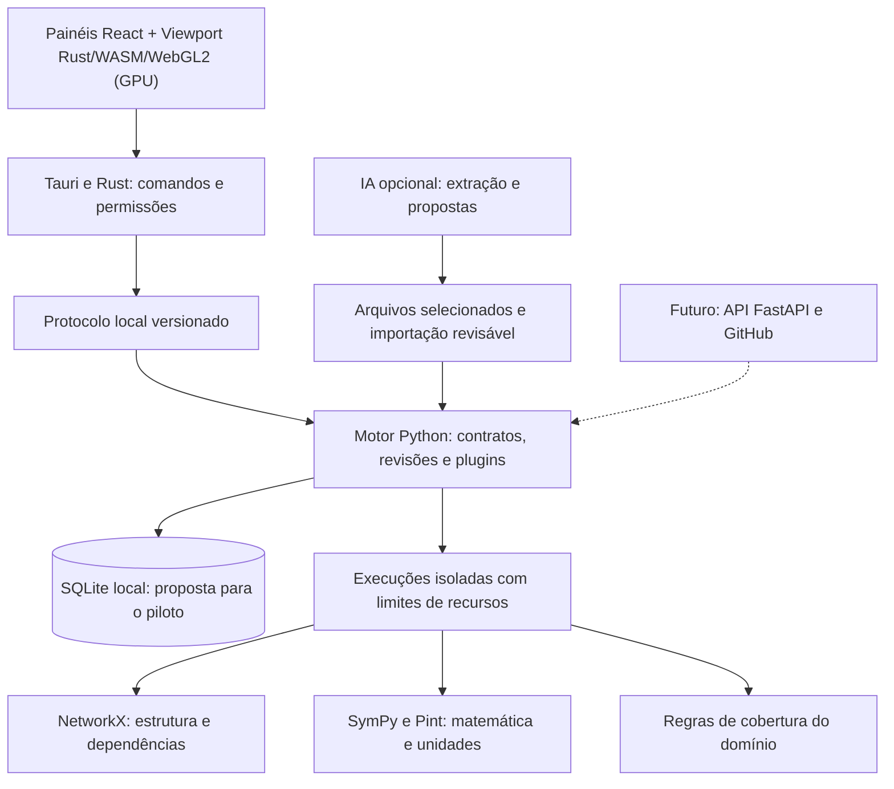

# Relatório inicial — Grafo de Conhecimento Matemático-Causal com Análise de Lacunas

Data: 23 de outubro de 2026. Estado: pesquisa e proposta técnica; inclui capacidades futuras. Para a implementação existente e testes executados, consulte [ESTADO_ATUAL.md](ESTADO_ATUAL.md).

## 1. Recomendação executiva

Construir um aplicativo desktop com interface gráfica desde o primeiro protótipo, preparado para uma futura versão online, para representar conhecimento verificável: problemas, fenômenos, equações, variáveis, hipóteses, evidências e resultados. O usuário deverá conseguir seguir o caminho entre um problema real e os modelos que o explicam, executar verificações e investigar lacunas com justificativa e rastreabilidade.

A arquitetura terá um núcleo comum e módulos de domínio. O primeiro domínio será um problema físico delimitado de balanço térmico em um edifício. Depois, o mesmo núcleo poderá receber verificadores para software, engenharia e outras ciências. A extensibilidade será testada com um segundo exemplo pequeno de rastreabilidade de requisitos de software, antes de considerar o núcleo suficientemente geral.

Direção acordada com o usuário: **Tauri com Rust** para o aplicativo desktop, **React + TypeScript + Vite + KaTeX** para os painéis e barras da interface, **Rust compilado para WebAssembly + WebGL2 na GPU (`packages/viewport-core`)** para o viewport e toda a representação de nós, portas, ligações e gráficos internos, e **Python 3.12 + Pydantic + SymPy + Pint + NetworkX** para o motor. A CLI será opcional. Recomenda-se SQLite para a persistência embarcada do piloto e PostgreSQL/FastAPI para a futura execução online; essas escolhas de armazenamento e transporte ainda precisam de prova técnica. Usar um núcleo modular, com análises matemáticas executadas em processos isolados. Z3, Lean, DoWhy, busca científica e regressão simbólica entram em etapas posteriores, conforme a necessidade demonstrada.

> **Nota de mudança de arquitetura do viewport (23/10/2026):** Inicialmente a visualização no viewport usava Cytoscape.js com sobreposição de cartões em HTML/DOM. Para garantir uma arquitetura mais robusta e evitar lag severo quando o viewport tiver centenas ou milhares de nós, toda a representação interna do viewport (layout por dependências, nós, portas estruturadas de entrada/saída/hipótese/requisito/validação, roteamento de ligações curvas e gráficos analíticos embutidos nos nós) passou a ser construída em **Rust e renderizada diretamente na placa de vídeo via WebAssembly + WebGL2**, sem elementos DOM/SVG por nó. Painéis e barras de ferramentas permanecem em React/TypeScript, e o motor científico permanece em Python.

O primeiro resultado demonstrável será um aplicativo gráfico com um grafo executável que encontra falhas introduzidas de propósito e apresenta a regra aplicada, a evidência, os limites da conclusão e um próximo passo de investigação. Não haverá promessa de descobrir novas leis ou de detectar todas as lacunas de qualquer área.

## 2. Escopo e método da pesquisa

O ponto de partida foi a conversa fornecida pelo usuário e a inspeção do repositório, que no início da pesquisa continha apenas um README. Foram consultadas páginas e READMEs de repositórios oficiais de projetos relacionados. As referências estão na seção 18 e o registro de acesso está em [FONTES_PESQUISA.json](FONTES_PESQUISA.json).

O ambiente retornou `403 Forbidden` do proxy ao tentar acessar diretamente vários sites de documentação. O conteúdo analisado veio das páginas oficiais acessíveis pelo GitHub, sem desativar TLS ou contornar autenticação. As APIs científicas, as bibliotecas e suas integrações não foram executadas nesta pesquisa. Documentação consultada não equivale a benchmark, auditoria ou validação de uma integração.

Esta é uma pesquisa técnica exploratória, não uma revisão sistemática da literatura nem uma demonstração de originalidade científica ou ausência de concorrentes. Versões exatas de pacotes serão fixadas após uma prova de compatibilidade; não se recomenda usar `latest` em ambientes reproduzíveis. Custos, requisitos de autenticação e limites de APIs externas devem ser confirmados no momento da integração, pois documentos podem ficar desatualizados.

## 3. O que as ferramentas existentes já oferecem

| Ferramenta ou projeto | Evidência encontrada | Como aproveitar | Limite para nossa proposta |
| --- | --- | --- | --- |
| Physics Derivation Graph [1] | Representação de conexões entre equações e verificação de algumas etapas com álgebra computacional | Referência para regras de inferência, equações e derivações | O próprio README documenta limitações e trabalho manual na equivalência entre representações; seus marcos históricos não provam o estado atual de toda a aplicação |
| SymPy [2] | Sistema de álgebra computacional em Python | Manipulação simbólica, substituição e resolução em classes suportadas | Resultado depende de domínio, hipóteses e algoritmo; ausência de solução retornada não prova inexistência |
| Pint [3] | Quantidades físicas, unidades e conversões | Consistência dimensional e normalização de dados | Coerência de unidades não valida a lei física ou a adequação do modelo |
| Z3 [4] | Prover/solver com bindings Python | Satisfatibilidade de restrições formalizadas | Pode retornar desconhecido ou atingir limite de tempo; não cobre toda matemática |
| Lean 4 + mathlib [5, 6] | Assistente de provas e biblioteca matemática | Verificar provas em módulos formalizados | Exige tradução formal e domínio especializado; uma prova não confirma hipóteses empíricas |
| NetworkX [7] | Estruturas e algoritmos de grafos | Alcance, componentes, dependências e ciclos | Topologia sem semântica do domínio não identifica omissões científicas |
| DoWhy [8] | Inferência causal com hipóteses explícitas e mecanismos de refutação | Análises causais delimitadas, com dados e modelo apropriados | Refutação aprovada não demonstra a verdade de uma estrutura causal |
| PySR [9] | Regressão simbólica com Python e Julia | Propor expressões candidatas a partir de dados | Ajuste preditivo não estabelece causalidade, novidade ou validade fora da amostra |
| GROBID [10] | Extração de PDFs científicos para XML/TEI | Metadados, referências e estrutura documental | Não assumir que reconstrói corretamente a semântica das equações ou das provas |
| OpenAlex e Crossref [11, 12] | Catálogo científico e metadados bibliográficos | Resolver fontes e enriquecer referências | Metadados não substituem texto completo, evidência experimental ou direito de reutilização |

O resultado prático é combinar componentes existentes com uma camada própria de semântica, requisitos de cobertura, verificações e auditoria. A integração e o modelo de evidência são o diferencial a desenvolver e validar. Não há base nesta pesquisa para afirmar que nenhuma plataforma semelhante exista.

ScienceStack, Kumu e Wolfram foram mencionados na conversa original, mas não foram avaliados funcionalmente nesta rodada. Não são usados como fundamento de uma alegação de superioridade ou de cobertura do mercado.

## 4. O que significa encontrar uma lacuna

Uma lacuna será um achado relativo a um **escopo declarado**, não uma conclusão de que o conhecimento científico universal está incompleto.

Exemplo: um modelo declara prever a potência térmica necessária para manter uma sala em determinada temperatura. Seu contrato de cobertura exige transmissão e avaliação da troca de ar. Se o grafo não registra a troca de ar nem uma hipótese justificando sua exclusão, há uma lacuna de modelagem em relação ao contrato. A distância visual entre dois nós não demonstra isso.

| Classe de achado | Condição verificável | Conclusão permitida |
| --- | --- | --- |
| Dependência não resolvida | Uma equação exige uma entrada sem valor, derivação ou condição de contorno | A execução está incompleta no escopo selecionado |
| Inconsistência dimensional | Operações violam as regras de dimensão cadastradas | A expressão ou a anotação de unidades precisa de correção |
| Restrição inconsistente | Restrições traduzidas para um solver são insatisfatíveis | O conjunto formalizado é incompatível nas hipóteses registradas |
| Hipótese sem justificativa | Uma hipótese obrigatória não tem evidência ou justificativa de exclusão | Falta documentação ou sustentação no modelo |
| Divergência empírica | Resíduo excede tolerância e incerteza predefinidas | O modelo precisa ser investigado; a causa ainda pode ser dado ruim, calibração ou termo omitido |
| Cobertura insuficiente | Um requisito explícito não tem relação de atendimento ou exclusão justificada | Existe uma omissão relativa à especificação adotada |
| Hipótese de descoberta | Uma relação candidata é sugerida por busca, IA ou regressão | Há uma proposta de investigação, ainda sem confirmação |

Toda regra terá pré-condições e poderá responder `inconclusivo`, `não aplicável` ou `erro de execução`. Essas respostas não contam como aprovação. A ausência de um achado também não demonstra completude do modelo.

## 5. Arquitetura proposta — desktop com motor local



Separar módulos por responsabilidade. Tauri gerenciará a janela, permissões de arquivos e o ciclo de vida do processo Python auxiliar, distribuído com o aplicativo. O usuário final não deverá precisar instalar Python, abrir terminal ou iniciar um servidor manualmente. Empacotamento, assinatura e compatibilidade por sistema operacional fazem parte da prova técnica; ainda não foram validados.

Para a comunicação local, recomenda-se avaliar mensagens JSON versionadas por stdin/stdout, com IDs de requisição, erros estruturados, progresso e cancelamento. Logs vão para stderr. Evitar um serviço HTTP local quando não for necessário; FastAPI permanece uma opção para execução online e integrações futuras. O transporte será separado da lógica científica.

Análises longas devem executar fora da thread da interface, com limites de CPU, memória e tempo. Uma fila local e um processo executor são suficientes para o piloto; Redis/Celery só entram se uma futura execução distribuída justificar. O encerramento do aplicativo deverá finalizar os processos que ele iniciou e preservar os resultados concluídos.

O fluxo principal será: criar ou importar um modelo → revisar suas relações → salvar revisão → executar verificações → explorar achados → testar uma correção → comparar execuções.

## 6. Stack e decisões

| Camada | Escolha atual | Motivo | Histórico / Alternativa |
| --- | --- | --- | --- |
| Aplicativo desktop | Tauri com Rust | Janela, permissões e ciclo de vida do motor local | Validar empacotamento e WebView no sistema escolhido |
| Motor | Python 3.12 e Pydantic [14] | Ecossistema científico e contratos tipados | FastAPI [13] como adaptador para futura versão online |
| Matemática | SymPy e Pint | Álgebra e unidades no mesmo ecossistema | Adaptadores para outros solvers quando um caso documentado exigir |
| Grafos em memória | NetworkX `MultiDiGraph` | Várias relações tipadas entre os mesmos nós e algoritmos disponíveis | Avaliar alternativas se volume ou latência ultrapassarem os critérios do piloto |
| Persistência | SQLite embarcado, SQLAlchemy e migrações: proposta a validar | Projetos locais sem instalar um serviço de banco | PostgreSQL no modo online; Neo4j apenas se consultas de grafos justificarem |
| Frontend (painéis e barras) | React, TypeScript e Vite na WebView Tauri | Painéis, barras de ferramentas, busca e inspetor fora do viewport | Separar acessos ao sistema de arquivos dos componentes visuais |
| Viewport, nós e ligações (GPU) | Rust + WebAssembly + WebGL2 (`packages/viewport-core`) | Arquitetura mais robusta: nós, portas tipadas (`E`, `S`, `HIP`, `REQ`, `VAL`), curvas roteadas e gráficos internos desenhados direto na placa de vídeo para suportar centenas/milhares de nós sem lag | Substituiu a escolha inicial de Cytoscape.js [15] + cartões DOM/SVG em 23/10/2026 |
| Equações | KaTeX, com configuração restritiva | Exibição de matemática no painel de detalhes | MathJax se requisitos de notação ou acessibilidade justificarem a troca |
| Estado de interface | Estado local React; TanStack Query quando necessário | Sincronização de consultas e tarefas pelo adaptador de transporte | Acrescentar store global apenas para fluxos que precisarem |
| Qualidade | pytest, Hypothesis, Ruff, verificação de tipos e Vitest; automação de UI a validar | Regressão científica, contratos e fluxo visual | Playwright para interface web; verificar suporte de automação da WebView Tauri por sistema |
| Ambiente | `uv`, npm e Cargo com lockfiles | Ferramentas de desenvolvimento reproduzíveis | Distribuição desktop deve incluir o motor Python; Compose é opcional no modo servidor |
| Busca textual | Recursos locais do SQLite a avaliar | Evita serviço adicional para um corpus pequeno | PostgreSQL e pgvector [17] na nuvem quando houver corpus e avaliação de recuperação |

Python 3.12 e Node.js 24 já estão disponíveis na máquina atual. Isso não comprova a compatibilidade de todas as dependências propostas. Rust/Cargo, Tauri, dependências de WebView, empacotamento Python, solvers e frontend ainda precisam ser verificados na etapa de implementação. Docker e PostgreSQL não serão requisitos para o usuário do desktop.

### Persistência local e futura execução online

O armazenamento precisa preservar projetos, revisões, evidências, arquivos e execuções, além de nós e relações. Recomenda-se SQLite para o piloto desktop por ser embarcado, sem serviço separado. Tabelas de nós e arestas atendem ao caso inicial, com índices por projeto, origem, destino e tipo; os dados flexíveis terão esquema validado na aplicação. O motor carrega subgrafos para análise com NetworkX. Não se deve carregar todo o acervo em memória nem renderizá-lo inteiro na interface.

PostgreSQL permanece recomendado para colaboração e execução online, com transações, concorrência e atributos JSONB. Separar a camada de persistência e prever exportação versionada, sem prometer portabilidade automática entre bancos. Migrações, semântica de consultas, backup e recuperação deverão ser testados em cada modo.

Neo4j é uma alternativa válida para travessias complexas. Contudo, não é um requisito inerente ao conceito e adiciona outra decisão operacional. Seu repositório distingue Community sob GPLv3 e Enterprise com licença comercial [18]; qualquer adoção deve considerar os componentes e a forma de distribuição efetivamente usados, sem inferir obrigações jurídicas apenas desta descrição.

### Evolução da visualização: de Cytoscape.js para Rust + WebAssembly + WebGL2 na GPU

Na proposta inicial deste relatório, Cytoscape.js [15] foi escolhido para o primeiro protótipo, complementado depois por cartões HTML/DOM sobrepostos ao canvas. Em 23/10/2026, o usuário revisou essa decisão de stack: embora painéis e barras de ferramentas funcionem bem em React/HTML, renderizar nós, ligações e gráficos internos em DOM/SVG ou JS convencional gera lag perceptível com centenas de nós e torna-se inviável com milhares, além de não organizar adequadamente as portas de entrada, saída e estados. Por isso, o viewport e toda a sua representação interna (nós, portas tipadas, curvas Bézier roteadas e gráficos analíticos embutidos) foram migrados para **Rust (`packages/viewport-core`) compilado para WebAssembly e renderizado na placa de vídeo via WebGL2**.

## 7. Modelo de conhecimento

### Entidades iniciais

| Entidade | Papel |
| --- | --- |
| `Problem` | Pergunta, objetivo e critérios de sucesso |
| `Phenomenon` | Fenômeno que o modelo procura explicar |
| `Model` | Escopo, hipóteses e componentes que explicam o problema |
| `Equation` | Relação matemática com representação estruturada |
| `Variable` / `Parameter` | Quantidade com identidade, dimensão, domínio e papel |
| `Assumption` / `Constraint` | Hipótese de validade ou restrição |
| `Observation` / `Dataset` | Medição, conjunto de dados e incerteza |
| `Claim` | Afirmação cuja sustentação será avaliada |
| `Source` / `Evidence` | Origem e trecho, dado ou resultado que sustenta uma afirmação |
| `Requirement` | Condição de cobertura explicitamente exigida |
| `VerificationRun` / `Finding` | Execução e resultado auditável |
| `Hypothesis` | Explicação candidata com plano de teste |

Relações iniciais: `DEPENDS_ON`, `DERIVED_FROM`, `EXPLAINS`, `ASSUMES`, `CONSTRAINS`, `SUPPORTED_BY`, `CONTRADICTS`, `VALIDATED_BY`, `REQUIRES`, `SATISFIES` e `CANDIDATE_CAUSE_OF`. Cada tipo terá origem e destino permitidos, significado, direção e regras de validação. Relações causais aceitas deverão registrar em qual modelo e sob quais hipóteses são aceitas.

Não converter uma dependência algébrica em relação causal automaticamente. A equação `F = m·a`, isoladamente, não determina o sentido de uma intervenção causal.

### Representação de equações

Guardar a expressão em uma AST/DSL JSON restrita, com operadores e funções permitidos e referências a IDs de variáveis. LaTeX será uma representação de exibição. Uma string LaTeX não será a fonte executável de verdade.

Exemplo conceitual:

```json
{
  "kind": "equation",
  "id": "eq_transmission",
  "lhs": {"var": "power_transmission"},
  "rhs": {
    "op": "mul",
    "args": [
      {"var": "thermal_transmittance"},
      {"var": "envelope_area"},
      {"var": "temperature_difference"}
    ]
  },
  "assumption_ids": ["steady_state"],
  "source_ids": ["pilot_model_spec"]
}
```

O identificador distingue duas variáveis chamadas `T` em contextos diferentes. Registrar unidade, dimensão, domínio, incerteza e contexto de aplicação. Diferença de temperatura deve ser distinguida de temperatura absoluta; conversões com offset merecem testes próprios. Expressões como `sqrt(x²) = x` exigem hipóteses sobre o domínio e não podem ser aceitas indiscriminadamente.

### Evidência, certeza e proveniência

Uma afirmação pode ter fontes diferentes e conflitantes. Evidências serão entidades próprias com URI/DOI quando disponível, localização no documento, licença conhecida, hash do arquivo quando aplicável e vínculo explícito com a afirmação que sustentam. Usar conceitos de entidade, atividade e agente do W3C PROV como referência de interoperabilidade [19], sem exigir RDF no piloto.

Separar três dimensões: origem da afirmação, estado de revisão humana e resultado de cada verificador. Não criar um único selo universal de “verdadeiro”. Uma expressão pode estar dimensionalmente consistente, inconclusiva simbolicamente e incompatível com observações.

Uma pontuação de IA será identificada como heurística, sem interpretação de probabilidade calibrada. Achados terão severidade, alcance, evidência e prioridade de investigação separados. Mudanças produzem novas revisões; execuções anteriores continuam apontando para a revisão e os dados usados originalmente.

## 8. Motor de verificações e plugins

Contrato sugerido: cada verificador recebe um snapshot do modelo, contexto de domínio e limites de execução; retorna resultados estruturados. Registrar ID e versão da regra, pré-condições, entradas, nós afetados, evidências, resultado, explicação e proposta de investigação. Guardar duração, versão do motor, parâmetros, tolerâncias e sementes quando houver aleatoriedade.

Primeiros verificadores:

1. **Integridade:** IDs duplicados, referências inexistentes e relações com tipos inválidos.
2. **Dependências:** entradas obrigatórias sem origem ou valor; análise orientada à variável de saída solicitada.
3. **Dimensões:** adições incompatíveis, unidades de entrada e saída e argumentos de funções.
4. **Cobertura:** requisitos não atendidos e hipóteses de exclusão ausentes.
5. **Consistência simbólica delimitada:** substituição e comparação em casos suportados, respeitando domínio e singularidades.
6. **Resíduos:** comparação com observações usando tolerância e incerteza declaradas antes da avaliação.

Um ciclo em dependências será classificado para investigação, não tratado automaticamente como erro. Sistemas simultâneos e feedback podem ter ciclos legítimos. A restrição de DAG será aplicada apenas a subgrafos que a exijam, como determinados modelos causais ou cadeias acíclicas de derivação.

Os plugins declararão tipos e propriedades adicionais, requisitos de cobertura, verificadores e limitações. Plugins são código confiável instalado pela equipe. Upload de plugins executáveis por usuários não faz parte do piloto. O núcleo não deve conter regras universais fictícias de completude para todos os domínios.

## 9. Primeiro caso de uso: balanço térmico

Usar um modelo educacional simplificado em regime estacionário, com fronteira, sinais e condições explícitos. Uma potência prevista pode ser representada por:

`P_prevista = U·A·ΔT + ρ·c_p·V̇·ΔT − P_solar − P_interna`

Unidades: `U` em W/(m²·K), `A` em m², `ΔT` em K, `ρ` em kg/m³, `c_p` em J/(kg·K), `V̇` em m³/s e potências em W. O modelo não cobre automaticamente transientes, umidade, eficiência do HVAC, pontes térmicas ou todas as trocas de um edifício real. O contrato deverá declarar como esses aspectos são tratados ou excluídos.

Para um exemplo sintético, `U=0,5`, `A=100` e `ΔT=20` produzem 1.000 W de transmissão. Com `ρ=1,2`, `c_p=1000` e `V̇=0,05`, a parcela de troca de ar é 1.200 W. Com ganhos solares e internos nulos, o total é 2.200 W. A remoção da parcela de troca de ar deixa uma diferença de 1.200 W neste conjunto construído. Esses números são didáticos, não dados experimentais nem descoberta científica.

| Cenário | Alteração introduzida | Resultado esperado |
| --- | --- | --- |
| Referência completa | Modelo e entradas consistentes no escopo | Verificações suportadas passam; limitações continuam visíveis |
| Entrada faltante | Remover o valor ou a origem de `U` | Identificar dependência não resolvida e bloquear o cálculo afetado |
| Unidade inválida | Informar área em metros | Apontar dimensão incompatível e os nós envolvidos |
| Cobertura omitida | Remover a avaliação da troca de ar exigida pelo contrato | Identificar requisito sem atendimento ou exclusão justificada |
| Observação divergente | Comparar previsão incompleta com 2.200 W sintéticos | Informar resíduo acima da tolerância, sem atribuir causa única |
| Restrição impossível | Exigir simultaneamente `x > 10` e `x < 5` | Etapa futura com Z3: insatisfatível nas restrições formalizadas |
| Condição fora do domínio | Entrada viola a hipótese estacionária | Informar inaplicabilidade ou alerta de validade, sem aprovação automática |

O piloto não deve procurar um “termo omitido” a partir de um resíduo isolado. A hipótese de troca de ar será sugerida com base no contrato de cobertura e no modelo físico cadastrado. Sua confirmação em um caso real exigiria medição ou evidência adicional.

## 10. Interface e experiência de uso

O aplicativo terá interface gráfica desde a fase 0. A primeira tela permitirá abrir um exemplo, importar um modelo ou selecionar uma pasta local. O usuário poderá iniciar e cancelar análises, acompanhar progresso e investigar resultados sem terminal. Selecionar uma pasta não implica compreender qualquer formato: cada analisador declarará as linguagens, arquivos e verificações suportados.

A seleção de arquivos será limitada ao escopo autorizado. Analisar uma cópia versionada dos arquivos, registrando hashes e alterações ainda não enviadas ao Git, sem modificá-los por padrão. Compilar, executar testes ou rodar scripts de um projeto exigirá uma ação explícita e um ambiente de execução adequado ao nível de confiança do conteúdo. Integração GitHub e CLI serão complementos futuros.

O fluxo deve começar pela pergunta e pela variável de interesse. A tela principal mostrará um subgrafo relevante, com expansão progressiva, busca e filtros por tipo, estado de verificação e fonte. Um painel lateral exibirá equação, entradas, unidades, hipóteses, evidências e resultados.

Cada achado abrirá um caminho explicativo: **o que foi detectado → por qual regra → usando quais entradas → com quais limites → como investigar**. O usuário poderá comparar revisões e execuções, inclusive após resolver uma lacuna.

Usar cor junto de ícone e texto; oferecer tabela/lista como alternativa ao grafo, navegação por teclado e rótulos acessíveis. Equações completas ficarão no painel, evitando rótulos extensos em todos os nós. Posição na tela não será usada como evidência científica.

## 11. IA, importação e descoberta

O piloto funcionará sem conta de LLM e sem acesso obrigatório a APIs externas. O primeiro formato de importação será JSON validado; CSV poderá fornecer observações. Equações e relações poderão ser revisadas manualmente.

Em uma fase posterior, IA poderá extrair candidatos de documentos, sugerir ligações e explicar resultados dos verificadores. Cada proposta terá texto de origem e estado de revisão. Conteúdo extraído será tratado como dado não confiável; instruções presentes em artigos não poderão comandar ferramentas ou alterar políticas do sistema.

GROBID pode fornecer a estrutura documental [10], mas equações exigem um caminho adicional de extração, desambiguação e revisão. Fontes via Crossref/OpenAlex devem passar por cache, deduplicação de DOI, retentativas limitadas e respeito a licenças. Autenticação, custos e cotas de produção permanecem pendentes de validação; não foram testados.

PySR só será avaliado quando houver dados adequados, separação de treino e teste, restrições de operadores, análise dimensional e comparação com baselines [9]. Uma relação ajustada será registrada como hipótese. Lean e mathlib entrarão por um demonstrador formal pequeno, com hipóteses explícitas e versão do toolchain fixada [5, 6]. Não haverá tradução automática irrestrita de artigos para provas verificadas.

## 12. Persistência, API e organização do código

Tabelas iniciais sugeridas: `projects`, `model_revisions`, `nodes`, `edges`, `sources`, `evidence`, `coverage_requirements`, `datasets`, `verification_runs`, `findings` e `audit_events`. Aplicar chaves estrangeiras, validação de projeto e índices de consulta. Atributos flexíveis não substituirão campos críticos de identidade e integridade.

O motor exporá operações tipadas independentes de transporte. No desktop elas serão chamadas pelo protocolo local; uma futura API FastAPI poderá mapear essas operações para os endpoints conceituais abaixo, a confirmar em OpenAPI:

- `POST /projects` e operações de leitura/edição de modelos com revisão explícita.
- `POST /projects/{id}/imports` para importação validada, sem execução de código.
- `GET /projects/{id}/subgraph` com filtros, paginação/limites e profundidade máxima.
- `POST /projects/{id}/verification-runs` recebendo revisão, conjunto de regras e parâmetros.
- `GET /verification-runs/{id}` e consulta dos achados da execução.
- `POST /projects/{id}/exports` para pacote versionado de grafo, dados permitidos e resultados.

Organização proposta, ainda não criada:

```text
apps/desktop/            Tauri e Rust: janela, permissões e processos
apps/ui/                 interface React compartilhável com a versão web
services/engine/         processo Python e protocolo local
services/api/            futuro adaptador HTTP, autenticação e contratos
packages/core/           entidades, revisões e contratos de plugins
packages/verification/   verificadores e execução isolada
packages/domains/        módulos térmico e de software
examples/                modelos e dados sintéticos versionados
tests/                   integração, regressão científica e fluxos de uso
infra/                   serviços e instruções de execução
docs/                    especificações, decisões e pesquisa
```

## 13. Segurança, confiabilidade e operação

Não usar `eval`, `exec` ou parser que avalie texto arbitrário para aceitar equações. Converter a AST restrita para objetos simbólicos por uma lista explícita de operações. Restringir tamanho, profundidade, número de símbolos e complexidade das expressões. Isolar execução matemática com limites de tempo, memória e CPU; limitar também tarefas concorrentes e tamanho dos subgrafos.

No desktop, configurar permissões Tauri mínimas, restringir comandos acessíveis pela WebView e impedir execução arbitrária de shell. Dados e verificações poderão permanecer locais; envio a IA externa, sincronização e telemetria de conteúdo exigirão escolha explícita do usuário. Um processo separado não constitui, sozinho, uma sandbox para executar código de terceiros.

O piloto será de desenvolvimento e uso controlado. Antes de exposição pública: autenticação por provedor OIDC, autorização por projeto, testes de isolamento entre usuários, políticas de arquivos, backup e restauração e limites de consumo. Revisão humana de uma proposta de IA não substitui controles de acesso e isolamento.

Importação de URLs deverá bloquear acesso a endereços privados e metadados de nuvem, limitar redirecionamentos e validar destinos. Não renderizar HTML não confiável de artigos ou respostas de IA. Tratar conteúdo, arquivos e resultados de solvers como entradas sujeitas a validação.

Registrar IDs de execução e versões para reprodução. Não registrar segredos nem textos privados integralmente em logs. Se houver LLM externo, tornar explícitos o envio de documentos, a retenção e o custo. Manter adaptador por provedor para reduzir dependência operacional.

## 14. Critérios de validação e sucesso

Criar um conjunto de referência versionado e revisado por alguém com conhecimento do domínio. Ele incluirá modelos válidos, defeitos conhecidos, casos inconclusivos e casos fora do escopo. Separar os exemplos usados para desenvolver regras dos usados para avaliar generalização.

| Dimensão | Critério proposto para o piloto |
| --- | --- |
| Correção do caso térmico | Reproduzir 1.000 W e 2.200 W no exemplo sintético, dentro de tolerância explicitada |
| Lacunas determinísticas | Detectar todos os defeitos especificados da suíte de aceitação, sem classificar os controles válidos como defeituosos |
| Qualidade fora da suíte | Medir precisão e recall por classe em casos separados; não extrapolar 100% da suíte para qualquer modelo |
| Resultados inconclusivos | Não converter timeout, erro de parser ou limitação do solver em aprovação |
| Rastreabilidade | Todo achado aponta para revisão, regra, entradas e evidência usada |
| Reprodutibilidade | Reexecutar o exemplo determinístico em ambiente limpo e obter o mesmo resultado normalizado |
| Interface | Pelo aplicativo gráfico, abrir/importar modelo, executar verificação, investigar achado e comparar revisão sem terminal |
| Distribuição desktop | Instalar em máquina de teste sem Python pré-instalado, iniciar e encerrar o motor, reabrir projeto e preservar dados |
| Extensibilidade | Adicionar o exemplo de requisito de software por plugin, sem reescrever o núcleo |
| Segurança | Rejeitar expressão executável, excesso de complexidade e acesso a recurso privado por importação |
| Desempenho | Medir tempo e memória em datasets crescentes; metas iniciais abaixo são hipóteses de engenharia |

Metas preliminares, ainda não medidas: análise determinística simples de um modelo com cerca de 100 nós em até 2 s no ambiente de referência; navegação inicial em subgrafo de até 300 nós em até 2 s na WebView e no sistema operacional de referência. Registrar hardware, tamanho das arestas e método de medição. Verificações simbólicas complexas terão orçamento de tempo próprio e poderão terminar inconclusivas. Essas metas não são garantias de desempenho.

Testes científicos devem incluir domínio de funções, singularidades, conversões de unidades com offset, ciclos legítimos e sensibilidade a incerteza. Para causalidade futura, registrar separadamente identificação, estimação e refutação; nenhuma etapa isolada será um selo de causalidade verdadeira [8].

## 15. Plano incremental

A estimativa anterior de **8 a 12 semanas** referia-se ao piloto web e não está validada para o produto desktop. A fase 0 deve medir o trabalho de empacotar Python, integrar Tauri e distribuir no primeiro sistema operacional escolhido. Reestimar depois dessa prova; suporte simultâneo a Windows, macOS e Linux exige validação e distribuição específicas e não cabe automaticamente na estimativa anterior.

| Fase | Entrega | Critério para avançar |
| --- | --- | --- |
| 0 — Prova desktop com interface | Janela Tauri, React, grafo mínimo, motor Python empacotado e cálculo térmico | Usuário abre exemplo e executa verificação graficamente no sistema-alvo |
| 1 — Núcleo e persistência | Contratos, revisões, banco local e primeiras regras integrados à interface | Modelo salvo e analisado com execução reproduzível; cancelamento funciona |
| 2 — Investigação visual | Subgrafos, evidências, achados e comparação | Fluxo completo funciona e casos de aceitação passam |
| 3 — Piloto e distribuição | Plugin de software delimitado, avaliação separada e instalador | Revisão de domínio, instalação limpa e reabertura de projetos validadas |

Etapas posteriores, sem prazo fechado: Z3 para restrições mais ricas; fontes científicas e documentos; demonstração formal com Lean; inferência causal com DoWhy; geração e teste de hipóteses com regressão simbólica e IA. Cada etapa terá um caso de uso e avaliação próprios antes de entrar no fluxo padrão.

### Backlog inicial em ordem de execução

1. Especificar o problema térmico, escopo, sinais, hipóteses e contratos de cobertura.
2. Criar o esquema de nós, relações, evidências, revisões e resultados.
3. Definir AST restrita, conversão simbólica e limites de execução.
4. Escolher o primeiro sistema-alvo e validar Tauri, WebView e distribuição do motor Python.
5. Implementar a janela e o exemplo térmico executável pela interface, com verificações científicas.
6. Persistir revisões e execuções; definir protocolo local e contratos de transporte.
7. Expandir o explorador de subgrafos e painel de investigação.
8. Avaliar controles válidos, defeitos conhecidos e casos inconclusivos.
9. Implementar o segundo domínio mínimo para testar o contrato de plugins.
10. Documentar instalação, inicialização, limitações e reprodução; só então ampliar importações e IA.

## 16. Recursos e custos

O núcleo proposto pode ser desenvolvido sem GPU, serviço pago de IA ou base vetorial dedicada. Para planejamento do desenvolvimento, considerar uma máquina com 4 vCPUs e 8 GB de RAM para o aplicativo e modelos pequenos; o requisito do desktop final será medido no sistema-alvo. Trata-se de uma reserva inicial a medir, não um requisito mínimo comprovado. GROBID, PySR, grandes grafos e execuções concorrentes exigem avaliação separada.

Custos principais: desenvolvimento, revisão científica, empacotamento, assinatura de instaladores quando aplicável, validação por sistema operacional, armazenamento, backups e manutenção. Hospedagem será necessária para os componentes online futuros. IA externa adiciona cobrança por uso; extração de documentos, buscas e geração de hipóteses devem ter limites por projeto. Não foram levantadas cotações de fornecedores nesta pesquisa, portanto não há estimativa monetária confiável.

A seleção privilegia componentes abertos, mas uma lista de dependências não constitui auditoria de licença. Antes de distribuir, registrar licenças das versões fixadas, componentes transitivos, dados, modelos e documentos incorporados. Manter avisos e permissões de redistribuição quando exigidos.

## 17. Riscos, decisões e questões em aberto

| Risco | Tratamento proposto |
| --- | --- |
| Tentar cobrir todas as ciências no início | Domínio térmico delimitado e segundo plugin pequeno para testar extensibilidade |
| Confundir grafo incompleto com descoberta científica | Contratos de cobertura, achados relativos ao escopo e revisão de hipóteses |
| IA produzir ligação plausível sem evidência | Propostas rastreáveis e separadas de resultados de verificadores |
| Equações equivalentes visualmente terem significados distintos | AST, identidade de variáveis, domínio, unidades e hipóteses explícitas |
| Explosão de custo simbólico e visual | Limites, subgrafos, cache por revisão, execução isolada e viewport Rust/WASM/WebGL2 na GPU |
| Interface visual esconder a justificativa | Painel de evidências e alternativa textual/tabelada |
| Integração científica depender de API instável | Adaptadores, cache, validação de autenticação/cotas e importação local independente |
| Regras refletirem erros do próprio modelo de domínio | Revisão especializada e avaliação com controles e casos fora da amostra |

Direção acordada com o usuário: aplicativo desktop em Tauri/Rust, painéis e barras em React/TypeScript, **viewport e nós construídos em Rust (WebAssembly + WebGL2 na GPU)** e motor científico em Python; interface gráfica desde o primeiro protótipo; otimizações adicionais no motor científico em Rust apenas após medir gargalos. CLI e execução online serão complementares. Recomendações ainda a validar: SQLite no desktop, protocolo local, estratégia de empacotamento e primeiro sistema-alvo. Permanecem o núcleo modular, matemática estruturada, IA opcional e o caso térmico didático proposto.

Questões para refinar durante a fase 0, sem impedir o protótipo: público prioritário; disponibilidade de especialista e dados reais; formato de colaboração entre usuários; restrições de implantação; política de privacidade; requisitos de escala; licença do projeto; necessidade de exportação RDF/PROV; e o conjunto de relações causais efetivamente suportado. Além da direção desktop e das linguagens acordadas, as escolhas detalhadas deste relatório permanecem recomendações técnicas a validar.

## 18. Referências consultadas

Consultadas em 23/10/2026 por HTTPS. A consulta cobriu o conteúdo disponível nas páginas dos repositórios; não constitui análise completa do código. Números de versão, preços e cotas não foram fixados a partir dessas páginas.

1. [Physics Derivation Graph — repositório do proof of concept](https://github.com/allofphysicsgraph/proofofconcept). Derivações, verificações parciais e limitações declaradas.
2. [SymPy](https://github.com/sympy/sympy). Sistema de álgebra computacional em Python.
3. [Pint](https://github.com/hgrecco/pint). Quantidades, unidades físicas e conversões.
4. [Z3](https://github.com/Z3Prover/z3). Solver e bindings, incluindo o pacote Python `z3-solver`.
5. [Lean 4](https://github.com/leanprover/lean4). Linguagem e assistente de provas.
6. [mathlib4](https://github.com/leanprover-community/mathlib4). Biblioteca matemática para Lean.
7. [NetworkX](https://github.com/networkx/networkx). Estruturas e algoritmos de grafos.
8. [DoWhy](https://github.com/py-why/dowhy). Inferência causal, hipóteses e refutação.
9. [PySR](https://github.com/astroautomata/PySR). Regressão simbólica com Python e Julia; endereço antigo redirecionou para este repositório.
10. [GROBID](https://github.com/grobidOrg/grobid). Estruturação de documentos científicos em XML/TEI; endereço antigo redirecionou para esta organização.
11. [OpenAlex — documentação](https://github.com/ourresearch/openalex-docs). Entidades e acesso a metadados; condições operacionais precisam de reconfirmação na integração.
12. [Crossref — REST API](https://github.com/CrossRef/rest-api-doc). Metadados, identificação do cliente e políticas de reutilização.
13. [FastAPI](https://github.com/fastapi/fastapi). API, OpenAPI e integração com Pydantic.
14. [Pydantic](https://github.com/pydantic/pydantic). Validação de dados e esquemas.
15. [Cytoscape.js](https://github.com/cytoscape/cytoscape.js). Modelagem, exploração e visualização de redes.
16. [xyflow / React Flow](https://github.com/xyflow/xyflow). Interfaces baseadas em nós com React/Svelte.
17. [pgvector](https://github.com/pgvector/pgvector). Busca vetorial no PostgreSQL, opcional em etapa posterior.
18. [Neo4j](https://github.com/neo4j/neo4j). Banco de grafos e distinção de licenciamento entre edições.
19. [W3C PROV — materiais do grupo](https://github.com/w3c/prov). Referência para proveniência; a especificação normativa [PROV-O](https://www.w3.org/TR/prov-o/) não pôde ser acessada diretamente nesta rodada.
20. [PostgreSQL](https://github.com/postgres/postgres). Repositório oficial do sistema de banco de dados; a documentação direta de JSON não pôde ser acessada nesta rodada.

As escolhas adicionais de ferramentas de UI, testes, ORM e empacotamento são recomendações de engenharia a validar na fase 0, não resultados de uma comparação experimental realizada nesta pesquisa.

## 19. Política de desempenho e uso de Rust

Separar quatro custos antes de otimizar: análise em Python, serialização e transferência de dados, cálculo do layout e renderização/interação na WebView. Medir duração, memória, tamanho das mensagens e responsividade em projetos representativos. Um motor Python mais rápido não resolve automaticamente um gargalo de desenho em JavaScript.

**Atualização de 23/10/2026 (Viewport e nós em Rust + GPU):** Para o cálculo de layout, construção dos nós, portas estruturadas, roteamento de curvas e renderização do viewport, a decisão arquitetural foi consolidada em **Rust compilado para WebAssembly com renderização WebGL2 na GPU (`packages/viewport-core`)**, eliminando elementos DOM/SVG por nó para garantir fluidez com centenas ou milhares de nós.

Para o motor científico (Python), permanecem as medidas de subgrafos relevantes, atualizações incrementais e avaliação pontual em Rust (via comando Tauri, PyO3 ou WASM) apenas se um algoritmo matemático ou de arquivo específico demonstrar gargalo medido.

Esta revisão registra a decisão de produto discutida com o usuário. Tauri, SQLite e os mecanismos de integração Rust/Python não fizeram parte da pesquisa original de 20 fontes, e sua compatibilidade deverá ser consultada e experimentada na fase 0.
